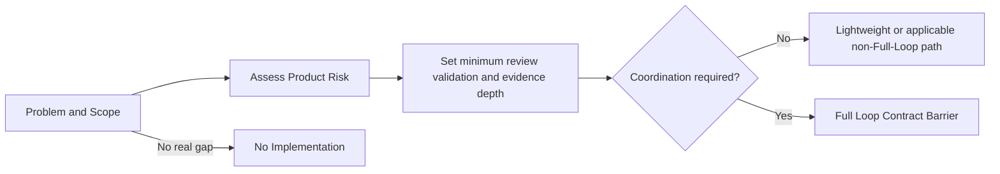
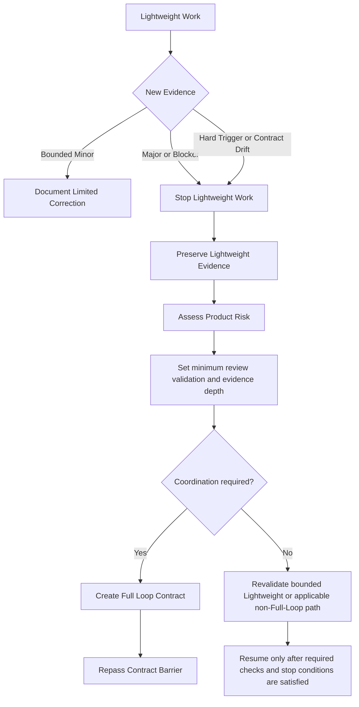
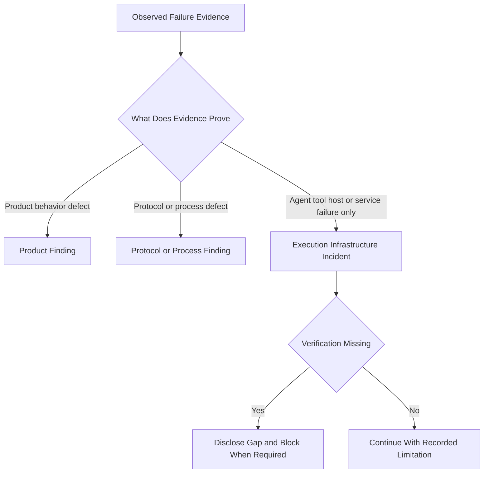

# Mode Selection and Escalation

## Authority and Timing

The Supervisor decides the mode. The Integrator records that decision. Mode
Selection does not own Project Status or Loop Status and does not change the
authority of PROJECT.md or LOOP-MAP.md.

Mode is selected before implementation and reassessed on new evidence in this order:

1. Assess Product Risk from the current problem, scope, Findings, and boundary evidence.
2. Set the minimum review, validation, and evidence depth for that risk, retaining
   Spec and Standards and adding risk-matched specialist review where required.
3. Reassess Coordination Necessity independently: can one owner plus bounded review
   safely express delivery, integration, correction, and recovery?
4. Select Full Loop only if that coordination requires it; otherwise Lightweight
   or the applicable non-Full-Loop path remains allowed. No Implementation is
   correct when no real gap remains. Risk-only changes preserve mode unless new
   coordination evidence independently requires a mode change.

This reassessment is a Supervisor decision recorded by the Integrator, not a new
runtime planner, lifecycle, or permission. A risk increase can require deeper
checks and a stop to reassess without requiring a Full Loop Contract.

No Implementation is correct when investigation finds no real gap. An Agent must
not implement first and backfill a rationale later.

## Product Risk and Coordination Necessity

Product Risk includes security, data, transaction, idempotency, sensitive-data,
compatibility, partial-success, and production-impact concerns. It determines the
required Review Depth, Validation Depth, and Evidence Depth.

Coordination Necessity asks whether delivery needs multiple implementation owners,
independently useful Deliveries, non-trivial integration ordering, formal Rework,
or active recovery. It determines whether Full Loop is warranted. High product risk
does not by itself prove that multiple Workers are required. See
[coordination necessity](coordination-necessity-and-delegation-fallback.md).

## Coding and Non-Coding Cases

The two axes remain separate for every kind of work:

| Scenario | Review depth | Mode decision |
| --- | --- | --- |
| High product risk / low coordination | Deep risk-matched review, validation, and evidence | Supervisor may justify one-owner Lightweight after evaluating hard triggers; high risk alone does not require multiple Workers |
| Low product risk / high coordination | Risk-matched review, never omit Spec or Standards | Full Loop when coordination cannot be safely expressed by one owner and bounded review |
| Multi-step non-coding / low coordination | Verify sources, facts, structure, or analysis as relevant | Lightweight by default for bounded documents, research, analysis, planning deliverables, or information organization |
| Multi-step non-coding / real coordination | Risk-matched review plus integration evidence | Evaluate Full Loop; non-coding is not an exemption from coordination requirements |

Real coordination evidence includes shared factual state with concurrent ownership,
multi-role dependency, parallel Workers, Integrator coordination, a dependency chain
across deliveries, or an explicit coordination requirement. Shared notes or several
sequential steps alone do not prove that Full Loop is necessary. The Supervisor must
decide from the actual boundary evidence, and re-evaluate on escalation evidence.
Advice-only planning still does not implicitly activate execution.

## Lightweight Tendency

Prefer Lightweight when most of these conditions hold:

- one verifiable change and one responsible owner;
- one language or a local module, with no cross-runtime contract;
- no SQLite, transaction, migration, data-consistency, sensitive-data, API-key,
  permission, security-boundary, or network-trust change;
- no partial-success, duplicate-mutation, corruption, or unrecoverable-state
  risk;
- no useful need for multiple Workers or independent integration proof;
- completion is realistic in one session with direct characterization tests;
- the change affects a small cohesive product surface;
- rollback is ordinary code reversion; and
- a short Change Contract can honestly express the scope.

One to four main product files is common supporting evidence, but file count is
supporting evidence, not the decision authority. A large file alone does not
justify Full Loop.

## Full Loop Hard Triggers

The following are hard reassessment triggers, not direct Full Loop selectors.
Stop affected Lightweight implementation and run the ordered reassessment above.
Risk or scope evidence sets the required checks first; coordination evidence then
determines whether a Full Loop Contract is necessary:

- a cross-language or cross-runtime contract;
- sensitive data, API keys, permissions, network trust, or another security
  boundary;
- SQLite transaction behavior, migration, partial success, corruption,
  duplicate writes, or unrecoverable state;
- multiple Workers with real parallel value, high-conflict files, or correctness
  demonstrable only after integration;
- coordination that cannot be safely expressed through a single owner plus bounded
  specialist review;
- active Checkpoint recovery or formal Finding, Rework, and reverification;
- scope too large for a stable short Change Contract;
- failure impact spanning domains or Loops; or
- a release-required or production-delivery obligation.

A hard trigger requires reassessment, not an automatic runtime decision.
Newly discovered high risk or a specialist Reviewer is not a hidden direct trigger
for Full Loop. Lifecycle consistency does not create another mode: Product Risk
still determines review and evidence depth, while Coordination Necessity determines
Full Loop. Before a Full Loop Contract Barrier, the Supervisor records actual
coordination evidence, grouping rationale, why Lightweight is insufficient, and
expected protocol cost. Without that coordination need, record the bounded path
and its risk-required minimum checks; do not waive checks to retain Lightweight.

## Lightweight Escalation

Stop affected implementation and escalate for mode reassessment when any of these occurs:

- a Major or Blocker Finding;
- scope expands into another language or runtime;
- SQLite, transaction, migration, sensitive-data, security, permission,
  partial-success, or duplicate-mutation impact appears;
- multiple implementation owners or an independent Integration Record becomes
  necessary;
- the same problem needs more than one correction;
- context cannot safely complete in the current session;
- the artifact budget expands materially; or
- the original Change Contract no longer describes the work honestly.

Escalation records the reason, preserves existing evidence, and repeats the ordered
risk, minimum-review-depth, and coordination assessment. If coordination requires
Full Loop, create the formal Contract and repass Contract Barrier before further
implementation. Otherwise the Supervisor may retain Lightweight or the applicable
non-Full-Loop path after revalidating scope, review and verification obligations,
correction limits, and recovery feasibility. A material scope change can keep work
stopped even without a mode change. Major or Blocker Findings, repeated corrections,
contract drift, and budget-stop controls cannot be bypassed by retaining a mode.
If required checks, review, safe recovery, or authority are unavailable, remain
stopped and disclose the gap. Lightweight self-review does not become Full Loop
Review, and an earlier correction is not automatically relabeled as Rework.

## Lightweight Artifact Budget and Accounting

The default target is four to seven Governance Artifacts. This is a Provisional
Heuristic for cost control, not a hard limit, lifecycle state, severity, Ledger,
or acceptance rule. A Supervisor may retain Lightweight above seven with a recorded
explanation and mode reassessment; continued growth or contract drift requires
escalation.

Product Artifacts (source, tests, allowed schema, and product configuration) and
Evaluation / Research Artifacts (plans, scorecards, baselines, manifests, and
comparative reports) do not consume this governance target. Report the artifact and
line counts for all three categories; do not hide experimental cost by calling it
governance.

A typical set contains State or Change Contract, Checklist, Review, Results or
Handoff, and only necessary recovery or test evidence. Lightweight does not
default to a Loop Map entry, full Loop Contract, Task Ledger, Finding Ledger,
multiple Worker Deliveries, Integration Record, Loop Closure, Project Closure,
Cross-Loop Validation, Project Acceptance, Release Readiness, or Final Delivery
Report.

## Product, Protocol, and Infrastructure Boundary

An Execution Infrastructure Incident is a recording classification for an Agent,
tool, host, dependency service, CI system, or packaging facility that did not
operate as expected without evidence of a product implementation defect. It is
not a new role, Finding status, severity, Ledger, or authority.

Examples include a Worker rate limit or 429, timeout, no output, host compaction,
dependency download outage, CI infrastructure failure, and local packaging-tool
failure. Record incidents in a Worker Delivery, Integration Record, Review
Report, Handoff, Results, or Checkpoint when they affect that artifact. Put an
incident in Checkpoint Must Load only when it affects recovery.

A Product Finding concerns implemented product behavior, such as incorrect data
semantics. A Protocol or Process Finding concerns violated governance, such as
an illegal Task status. Both may enter the existing Finding Ledger through the
existing authority. A 429 or timeout does not automatically become a Product
Finding, but a tool failure can reveal evidence that separately proves one.

No output must not be converted into a fabricated Worker Delivery. Missing
verification can block Review or Closure without proving product failure.

## Specialist Reviewers

Spec and Standards are permanent independent axes. Specialist Reviewers are
risk-loaded and do not replace those axes or create a new authority:

| Reviewer | Load when evidence includes |
| --- | --- |
| Security | API keys, SSRF, credentials, permissions, authentication, network trust, redirects, sensitive logs or data, import/export, hostile input, or Tauri capabilities |
| Data | SQLite, transactions, migrations, partial success, data preservation, rollback, foreign keys, concurrency, consistency, corruption, or durable mutations |
| Compatibility | Language or runtime boundary, DTOs, serialization, API/schema/version evolution, host boundaries, or backward compatibility. Examples: TypeScript/Rust or Web/Tauri. |
| Operations | deployment, rollback, observability, runbooks, alerting, production delivery, or operational recovery |
| Accessibility | UI focus, keyboard use, screen readers, or mobile accessibility |

Full Loop does not automatically load every specialist. A Reviewer may cite an
Execution Infrastructure Incident as evidence, but must not turn it into a
Finding without product or protocol proof. Reviewers do not modify the
implementation under review.

## Baseline and Verification Surface

Record Repository, Environment-Corrected, and Scope-Focused Baselines before
claiming a regression. A passing command proves only the tests it actually selected;
record its includes, excludes, unreached tests, prerequisites, and focused versus
full validation. See [baseline evidence](baseline-evidence-and-verification-surface.md).

## Architecture Selection

OOP, DDD, DI, MVVM, and zero-copy are evidence-selected options. Choose them
only when domain invariants, ownership, test seams, view/application coupling,
allocation measurements, or benchmarks justify the added structure. Do not
force DDD into every Full Loop, add a large DI framework by default, forward
state through MVVM without a real view boundary, make a class for a pure helper,
or claim zero-copy value without measurement.

## Decision Record

The Project Template and Loop Contract record candidate mode, observed evidence,
hard triggers, expected artifact budget, escalation conditions, Supervisor
decision, Integrator record, active specialist Reviewers, rejected Lightweight
rationale when Full Loop is selected, and recovery implications. These fields
describe a decision; they do not add a status or Ledger.
